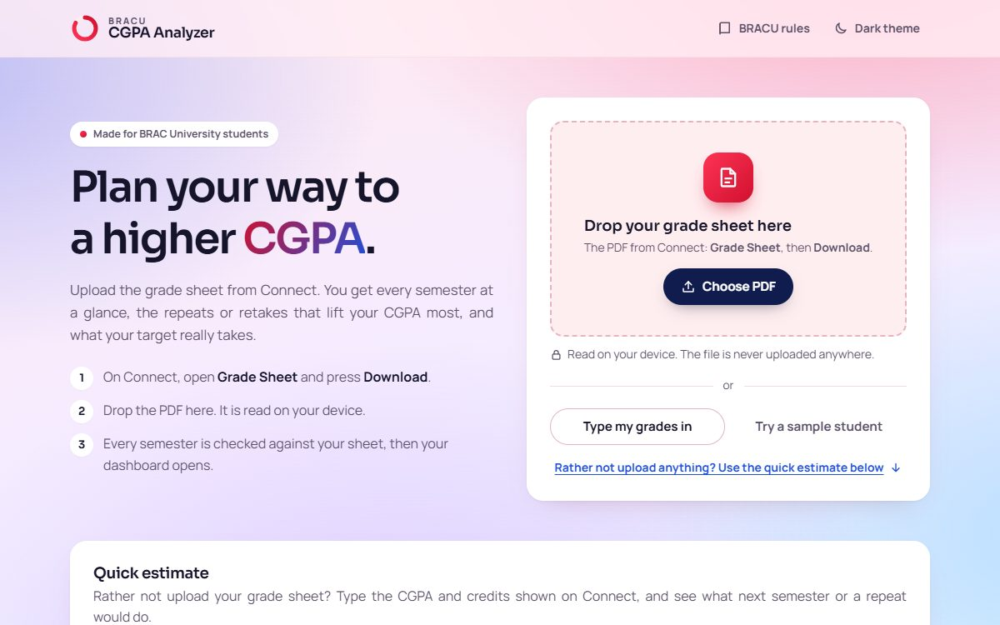
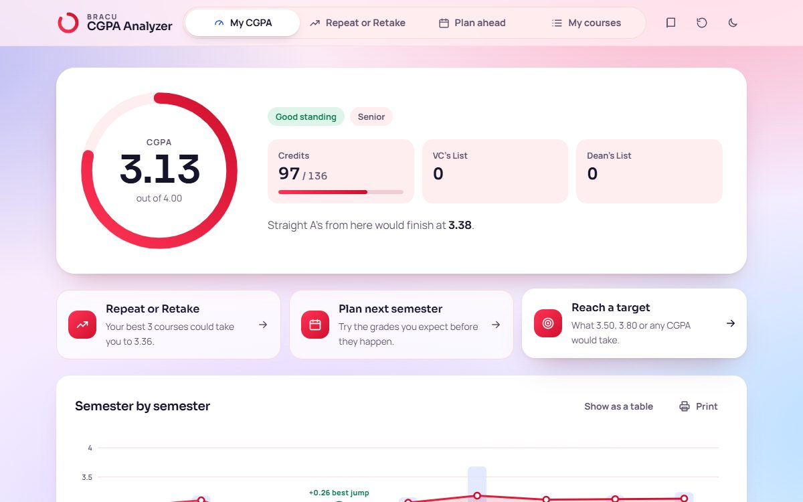
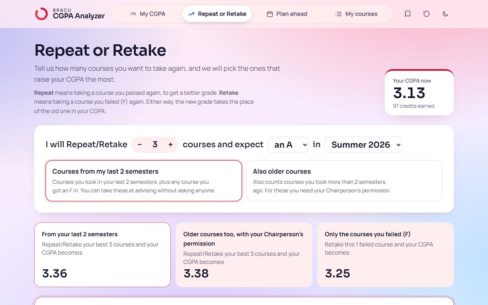

# BRACU CGPA Analyzer

[](https://github.com/FaiazPronoy/BRACU-CGPA-Analyzer/actions/workflows/pages.yml)

**A CGPA planner for BRAC University students.**
Upload your grade sheet and plan ahead: find the fastest way to raise your CGPA.

| | |
|---|---|
| **Type** | Personal project, made for BRACU students (not for a course) |
| **Made by** | Faiaz Abrar Zaman Pronoy |
| **Live** | https://faiazpronoy.github.io/BRACU-CGPA-Analyzer/ |
| **Runs** | Fully in the browser. No account, no server. Your grade sheet never leaves your device. |

| | |
|---|---|
|  |  |



---

## Features

**My CGPA**
- Upload the grade sheet PDF from Connect, try a sample student, or type your grades
- Works out every semester again and checks it against the sheet
- Shows your CGPA, standing, credits done, and VC's List and Dean's List count
- A graph of your CGPA and GPA over time, with the probation line
- Your CGPA at graduation if you get all A, all A-, or any grade you choose

**Repeat or Retake**
- Say how many courses you will take again and the grade you expect
- It picks the courses that raise your CGPA the most
- Shows which courses you can take at advising and which need the Chairperson's permission
- Or tick courses yourself and watch your CGPA change

**Plan ahead**
- Try next semester's courses
- See the grades you need for a target CGPA
- What if: change a grade or drop a course without touching your real grades
- Quick estimate from just your CGPA and credits

**My courses**
- Add, edit or remove any course or semester
- Undo button while you edit, and Start over to clear everything

**Also**
- BRACU rules page that explains the grading policy in simple questions
- Light and dark mode
- Works on phones
- Number keys 1 to 4 switch between pages

---

## How it counts

It follows BRAC University's published rules:

- **Repeat** (a passed course): the latest grade counts
- **Retake** (after an F): the best grade counts
- **P, I and W** do not count in the GPA
- **Rounding** works like Connect: three decimals first, then two
- **VC's List:** semester GPA 3.90 or more. **Dean's List:** 3.70 to 3.89
- **Probation:** CGPA under 2.00

Checked against 4 real grade sheets: all 288 numbers match exactly.

---

## Built with

- **React 18** and **TypeScript**
- **Vite** for the dev server and build
- **pdf.js** to read the grade sheet PDF
- Plain CSS, with a hand-drawn SVG chart (no chart library)
- Fonts: Sora and Manrope
- **Vitest** for tests, **Playwright** for browser checks

---

## Run it

You need **Node 20** or newer.

- **Windows:** double-click `RUN-BRACU-CGPA-Analyzer.bat`
- **By hand:**

```bash
npm install
npm run dev
```

Then open <http://localhost:5180>.

---

## Tests

- `npm test` runs **61 unit tests** that cover every rule above
- `tools/browser_checks.py` opens every page in light and dark mode and checks colour contrast and phone width
- Real grade sheets stay private. Put your own in `fixtures/private/` and `npm test` checks them too

---

## Put it online

It is a static site. Run `npm run build` and upload the `dist/` folder to
Netlify, Vercel, Cloudflare Pages or GitHub Pages.

---

## Folder layout

```
src/
  engine/      the CGPA rules, the PDF reader and their tests
  pages/       one file per page
  components/  shared pieces (chart, upload, dialogs, what if)
  sample.ts    the sample student
tools/         browser checks
```

---

## Not official

This is an independent student tool, not a BRAC University service.
For anything important, confirm with your advisor.

---

## Author

- **Faiaz Abrar Zaman Pronoy**, developer

## Licence

Copyright 2026 Faiaz Abrar Zaman Pronoy. All rights reserved.
You may read the code and run it to try it out. You may not copy it, hand it in
as your own work, or publish it. See [LICENSE](LICENSE).
